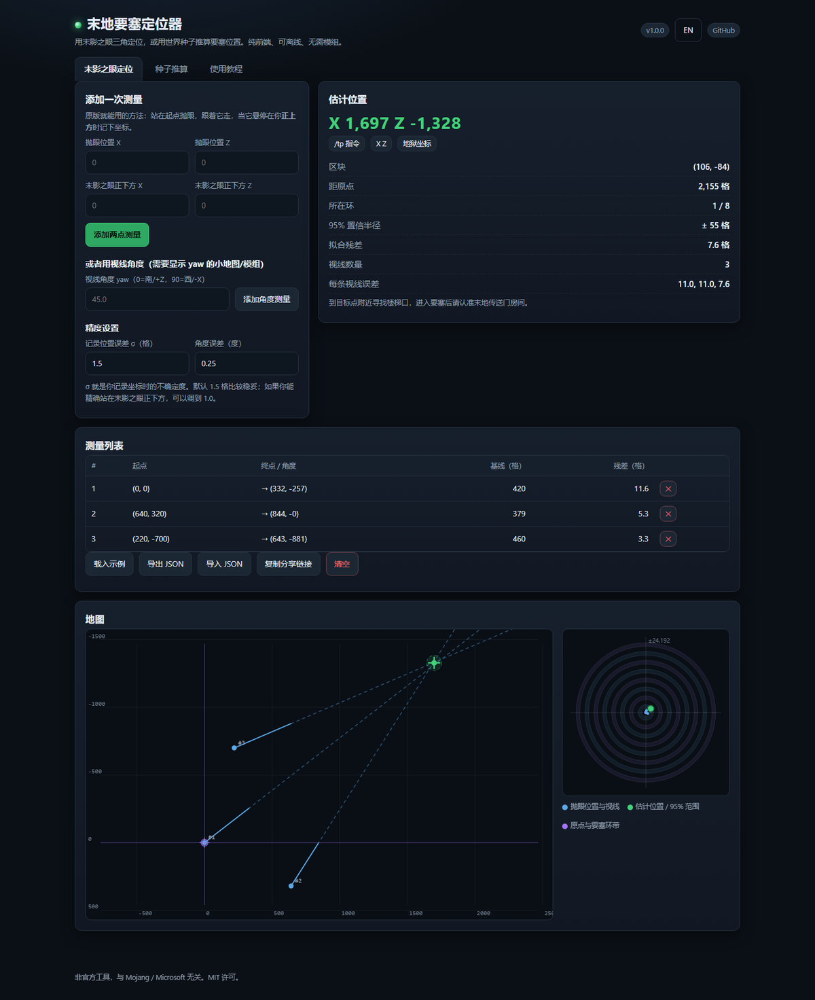
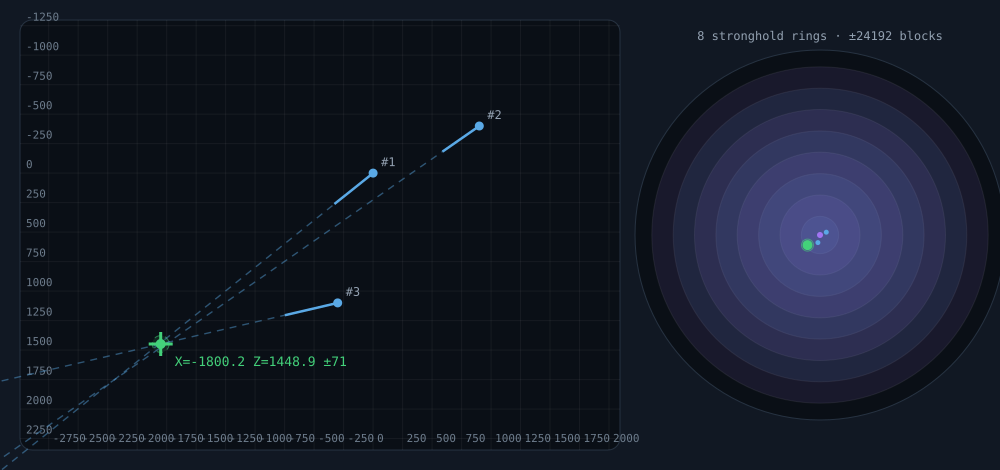

# 末地要塞定位器 · Minecraft Stronghold Finder

用**末影之眼三角定位**，或者直接用**世界种子**推算末地要塞（要塞 / Stronghold，也就是末地传送门所在的结构）的位置。
纯前端、零依赖、可离线，也可以当命令行工具用。

[](https://github.com/YuHeng1412/minecraft-stronghold-finder/actions/workflows/ci.yml)
[](LICENSE)
[](package.json)
[](package.json)

**在线使用：<https://yuheng1412.github.io/minecraft-stronghold-finder/>**



> 非官方工具，与 Mojang / Microsoft 无关。

---

## 功能

| 功能 | 说明 |
| --- | --- |
| 末影之眼三角定位 | 记录「抛眼位置」和「末影之眼正下方的位置」，用加权最小二乘求交点，支持 3 条以上测量互相纠错 |
| 置信度评估 | 输出 95% 置信半径、每条视线的残差、两两夹角、方向一致性检查，并给出通俗的中文警告 |
| 种子推算 | 1.19.3 – 26.3（含 26.1 / 26.2 / 26.3）可以只凭种子算出全部 128 个要塞的理想点；旧版本如实只给第 1 个 |
| 地图可视化 | 局部的测量/交点视图 + 以原点为中心的八环总览图 |
| 便捷功能 | 一键复制坐标 / `/tp` 指令 / 下界坐标、按基线长度自动加权、JSON 导入导出、分享链接、中英文切换 |
| 命令行 | `eye` 与 `seed` 两个子命令，支持 `--json` / `--csv`，方便脚本化 |

所有计算都在浏览器本地完成，不联网、不上传任何数据。

---

## 快速开始

### 1. 在线版（推荐）

打开 <https://yuheng1412.github.io/minecraft-stronghold-finder/>，直接用。

### 2. 单文件离线版

下载 [`dist/minecraft-stronghold-finder.html`](dist/minecraft-stronghold-finder.html) 双击打开即可，样式和脚本都内嵌在这一个文件里。

仓库根目录的 `index.html` 用的是 ES 模块，**双击打开会被浏览器的同源策略拦截**，需要走 http 服务：

```bash
node tools/serve.mjs        # 然后访问 http://localhost:8123/
```

### 3. 命令行

```bash
git clone https://github.com/YuHeng1412/minecraft-stronghold-finder
cd minecraft-stronghold-finder

# 三角定位：--measure 抛眼X,抛眼Z,正下方X,正下方Z
node src/cli.mjs eye --measure 0,0,58,-290 --measure 512,140,556,-140

# 也可以用朝向角：--yaw X,Z,yaw（0=南/+Z，90=西/-X）
node src/cli.mjs eye --yaw 0,0,168.7 --yaw 512,140,171.1

# 种子推算
node src/cli.mjs seed -4172144997902289642 --ring 1
node src/cli.mjs seed "hello world" --version 1.16.5 --limit 5
```

---

## 用法一：末影之眼定位（任何版本都能用）

1. 准备 **2 个以上**末影之眼（3 个以上更稳），不需要任何模组。
2. 站在 A 点，记下 F3 里的 `X / Z`，抛出末影之眼。
3. 跟着末影之眼走，当它**悬停在你正上方**时，记下新的 `X / Z`。
4. 把两组坐标填进「抛眼位置」和「末影之眼正下方」，点「添加两点测量」。
5. 沿**大致垂直于视线**的方向走 300 ~ 1000 格到 B 点，重复一次。
6. 两条线出现交点后结果立刻显示；再测第三、第四次会更准。

> 如果小地图/HUD 能显示朝向角 yaw，也可以在同一个点完成测量：把准星对准末影之眼读出 yaw，用「角度测量」录入。

**读结果**

* 绿色十字是估计位置，虚线圆是 95% 置信半径。
* 「所在环」用来判断结果是否合理：要塞只会落在 8 个环带里。
* 出现「有视线的反方向才指向交点」的警告，通常意味着两次抛眼瞄到了**不同的要塞**，重测即可。
* 到点后找苔石砖 / 石砖的楼梯，一路向下就是末地传送门房间。

**为什么两条线就够？** 末影之眼永远朝着它所属要塞的生成点飞，所以「抛眼点 → 末影之眼正下方」这条线一定穿过要塞。两次不同位置的抛眼就是两条线，交点即要塞。测量有误差时两条线不会严格相交，3 条以上用最小二乘找「离所有线最近的点」，误差可以互相抵消。

---

## 用法二：种子推算

Minecraft 从 1.9 起把最多 128 个要塞按 **8 个同心环**摆放：先在某个环上算出一个「理想点」（区块中心），再把要塞挪到 112 格内最近的、允许生成要塞的生物群系里。本工具复现的是这个**理想点**——也正是末影之眼瞄准的位置。


| 版本 | 生物群系搜索用的随机源 | 本工具能给出 |
| --- | --- | --- |
| **1.19.3 – 26.3**（含 26.1 / 26.2 / 26.3） | 每个要塞 `fork()` 出独立随机源（只消耗 1 次 `nextLong`） | **全部 128 个**理想点，误差 ±112 格 |
| **1.9 – 1.19.2** | 直接消耗环形随机数流（每个要塞上千次抽取） | 只有**第 1 个** |
| **1.8 及更早** | 同上 | 只有**第 1 个**（旧算法共 3 个要塞） |

为什么旧版本只能给第 1 个：生物群系搜索每命中一个合法生物群系就要抽一次随机数，而搜索范围是 ±112 格（约 3000 个采样点），因此第 2 个要塞之后的角度和距离取决于地形，光靠种子算不出来——它需要完整生成地图的生物群系。与其给出错误的坐标，本工具选择只报告能算准的那一个。

**推荐用法**：先算出第 1 个要塞的理想点 → 走过去 → 用末影之眼三角定位精确锁定楼梯口。

各环的距离区间（方块，距原点）：

| 环 | 1 | 2 | 3 | 4 | 5 | 6 | 7 | 8 |
| --- | --- | --- | --- | --- | --- | --- | --- | --- |
| 要塞数 | 3 | 6 | 10 | 15 | 21 | 28 | 36 | 9 |
| 距离 | 1408–2688 | 4480–5760 | 7552–8832 | 10624–11904 | 13696–14976 | 16768–18048 | 19840–21120 | 22912–24192 |

---

## 精度说明



*示意图由 `node tools/make-example-svg.mjs` 用与工具完全相同的求解器生成。*

* **三角定位**：误差主要来自「站在末影之眼正下方」这一步。工具按 `σ_垂直 = sqrt(σ_位置² + (R·σ_角)²)` 给每条视线加权，其中 `R` 是到交点的距离、基线越长角度越准，所以**走得越远、抛得越分散，结果越准**。输出的 95% 置信半径就是据此算出的。
* **种子推算**：理想点与真实楼梯口的差距来自游戏的生物群系重定位，**上限 112 格**；要塞楼梯永远位于所在区块的 `(4, 4)`，理想点在区块中心 `(8, 8)`，两者同区块。接近目标后请再抛一次末影之眼确认。

---

## 命令行参考

```
stronghold-finder eye  [选项]          末影之眼三角定位
stronghold-finder seed <种子> [选项]    由世界种子推算要塞理想点
stronghold-finder rings                打印各环的距离区间

eye 选项
  --measure x1,z1,x2,z2   抛眼位置 + 末影之眼正下方位置（可重复）
  --yaw x,z,yaw           抛眼位置 + 视线朝向角（可重复）
  --sigma <格>            记录位置的误差，默认 1.5
  --yaw-sigma <度>        角度误差（配合 --yaw），默认 0.25
  --json                  输出 JSON

seed 选项
  --version <版本>        modern | classic | legacy | 1.21 | 1.16.5 ...（默认 modern）
  --ring <1-8>            只看某一环
  --limit <n>             最多输出 n 个
  --csv / --json          机器可读输出
```

种子可以是数字（含 64 位大整数）或文本；文本种子会像游戏一样按 Java `String.hashCode()` 转换。

---

## 开发

```bash
node test/run.mjs          # 运行全部测试（零依赖）
node tools/build.mjs       # 生成单文件版 dist/
node tools/build.mjs --check   # 检查单文件版是否是最新的（CI 用）
node tools/serve.mjs       # 本地 http 服务
```

目录结构：

```
index.html                  页面骨架（模块版，需 http 服务）
src/java-random.js          java.util.Random 的 BigInt 逐位复刻
src/stronghold.js           要塞八环布局（原版算法）
src/triangulate.js          加权最小二乘三角定位
src/app.js                  界面逻辑（中英双语、地图、持久化）
src/cli.mjs                 命令行
test/                       43 项测试 + 极简 DOM 桩
tools/build.mjs             单文件打包器
dist/                       打包产物（可直接双击打开）
```

测试覆盖：`java.util.Random` 官方参考值、八环数量与距离区间、理想点与楼梯口同区块、版本分界、三角定位的精确解 / 噪声 / 近乎平行 / 反向 / 退化输入 / 置信半径覆盖率，以及用 DOM 桩把整个界面跑一遍的冒烟测试。

---

## 正确性验证

算法正确性做了三层校验，都可以复现：

1. **对照原版反编译源码**：`ChunkGenerator.generateStrongholds`（1.18.1）与 `ChunkGeneratorStructureState.generateRingPositions`（1.21.x、**26.3**），逐条核对距离公式、`+8` 区块中心偏移、`spread` 增长与封顶、以及 1.19.3 起每次放置消耗的一个 `nextLong`（`RandomSource.fork()`）。
   * 26.3 另核对了 `data/minecraft/worldgen/structure_set/strongholds.json`（`count=128, distance=32, spread=3, salt=0`）、`ConcentricRingsStructurePlacement` 的字段范围，以及 `ChunkGenerator.findNearestMapStructure`——其中确认要塞的目标点就是区块中心 `(chunkX·16+8, chunkZ·16+8)`，且环形布局不受 100 区块搜索半径限制（该半径只作用于 `RandomSpreadStructurePlacement`）。
2. **与独立实现交叉比对**：

   ```bash
   git clone --depth 1 https://github.com/PrismarineJS/prismarine-rng /tmp/prismarine-rng
   node test/cross-check.mjs /tmp/prismarine-rng
   # compared 19968 ideal stronghold positions over 156 seeds
   # OK: both implementations agree on every position
   ```

   做法是给 prismarine-rng 传入一个「消耗 1 次 `nextLong` 后返回未重定位」的生物群系桩，让它按 1.19.3+ 的随机流走一遍。
3. **单元测试**：`node test/run.mjs`。

如果你有真实存档的要塞坐标，欢迎开 issue 反馈偏差，用来继续收紧 ±112 格这个上界。

---

## English

**Stronghold Finder** locates Minecraft strongholds (the structures holding the end portal) in two ways: by triangulating thrown eyes of ender, and - on 1.19.3 through 26.3 - straight from the world seed.

* **Eye triangulation** works on every version and needs no mods. Throw an eye, walk until it hovers directly above you, and record both positions. Two such lines cross at the stronghold; three or more are combined with a weighted least squares fit that also reports a 95% confidence radius, per line residuals and geometry warnings.
* **Seed prediction** reproduces vanilla's concentric ring placement. On 1.19.3 - 26.3 the biome search forks its own random source, so all 128 ideal stronghold points follow from the seed alone (accurate to ±112 blocks, the radius vanilla uses to relocate a stronghold into a valid biome). On 1.9 - 1.19.2 and 1.8 the biome search eats into the shared ring random, so only the first stronghold is predictable - this tool reports exactly that one instead of inventing the rest.

Everything runs offline in the browser (zero dependencies) and there is a CLI: `node src/cli.mjs eye --measure 0,0,58,-290 --measure 512,140,556,-140`.

The algorithm is verified against decompiled vanilla sources and cross-checked position by position against [PrismarineJS/prismarine-rng](https://github.com/PrismarineJS/prismarine-rng) (see "正确性验证" above).

---

## 许可

[MIT](LICENSE)。Minecraft 是 Mojang Studios 的商标，本项目为非官方工具，未获得 Mojang 或 Microsoft 的认可或关联。
